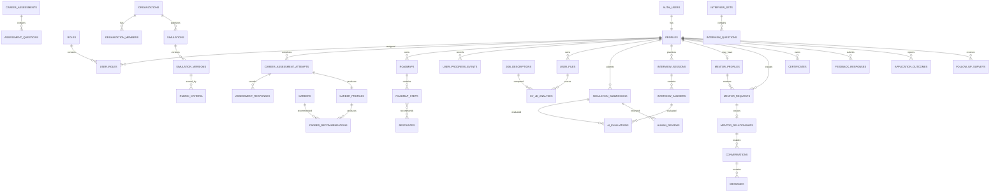

# AI-Powered Career Readiness Platform
## Product, Architecture, Data, AI, Security, Testing, and Delivery Master Plan

**Document type:** AI Agent implementation blueprint  
**Language:** English  
**Version:** 1.0  
**Prepared:** 2026-07-27  
**Target product stage:** MVP to production-ready pilot  
**Recommended architecture:** Modular monolith  
**Primary users:** Students, early-career candidates, mentors, employers, and platform administrators

---

## 0. How the AI Agent Must Use This Document

This document is the implementation source of truth. The AI Agent must:

1. Implement work in the dependency order defined in the delivery backlog.
2. Never expose service-role keys, database credentials, AI API keys, or email credentials to the browser.
3. Add database migrations before writing application code that depends on new data structures.
4. Add tests in the same pull request as the feature.
5. Use strict TypeScript, schema validation, explicit error handling, and structured logging.
6. Treat AI output as untrusted input:
   - Validate every AI response against a schema.
   - Reject malformed output.
   - Never directly execute model-generated code or SQL.
   - Never allow an AI score to make an employment decision.
7. Keep all scoring criteria visible to users.
8. Use deterministic logic where possible and AI only where natural-language interpretation adds value.
9. Apply Row Level Security to every user-accessible database table.
10. Stop a feature from being considered complete until its acceptance criteria and required tests pass.

The Agent should create one small, reviewable implementation unit at a time. Each unit must include:

- Code
- Migration, if applicable
- Tests
- Seed or fixture data, if applicable
- Documentation update
- A short verification note

---

# 1. Product Vision

Build a career-readiness platform that helps students and early-career candidates:

- Discover suitable career directions.
- Receive a personalized development roadmap.
- Practice realistic job simulations.
- Practice company-specific interview stages.
- Receive transparent AI feedback.
- Connect with verified mentors.
- Track real application outcomes.
- Earn a verifiable completion certificate.

The platform must not present personality tests or AI scores as absolute truths. It should help users make better-informed decisions, practice skills, and identify gaps.

---

# 2. Product Principles

## 2.1 Human-in-the-loop by design

AI supports learning and feedback. Employers, mentors, and users remain responsible for final interpretation.

## 2.2 Evidence over opaque scores

Every score must include:

- The rubric criterion.
- The criterion weight.
- Evidence from the user's submission.
- What was done well.
- What should improve.
- A confidence level.
- An escalation path to Mentor review.

## 2.3 Realism through verified contributors

Simulation tasks and company-specific interview content must follow this publishing workflow:

```text
Employer or Mentor creates draft
        ↓
Content owner adds rubric and expected evidence
        ↓
Second reviewer validates realism and clarity
        ↓
Admin approves publication
        ↓
Version is locked and published
        ↓
Feedback and outcome data inform later revisions
```

## 2.4 Privacy-first AI

CVs, interview responses, recordings, and application outcomes are personal data. They must not be sent to an unpaid AI service that permits model improvement or human review of submitted content.

## 2.5 Progressive delivery

The MVP should implement the smallest reliable version of every core journey. Advanced capabilities should be added only after core workflows, authentication, permissions, and tests are stable.

## 2.6 Content scoring, not identity scoring

The platform must not score or infer ability based on:

- Accent
- Regional speech
- Gender
- Facial expression
- Camera quality
- Voice pitch
- Speaking speed, unless the user explicitly asks for presentation coaching and it is not included in the employment-readiness score
- Disability-related characteristics
- Device quality

Interview scoring should use the transcript and task content only.

---

# 3. Scope

## 3.1 MVP scope

The MVP includes:

1. Email/password sign-up and sign-in.
2. Email verification and password reset.
3. Student/Mentee onboarding.
4. Mentor and Employer applications with admin approval.
5. RIASEC-based career discovery assessment.
6. Top-three career recommendations with transparent explanation.
7. Personalized roadmap.
8. CV upload and CV–job-description gap analysis.
9. Text-based AI chatbot grounded in platform resources.
10. Employer/Mentor-authored simulations.
11. AI rubric scoring with evidence.
12. Mentor review and appeal workflow.
13. Text interview practice.
14. Optional recorded voice answer converted to transcript.
15. Mentor discovery and booking requests.
16. Basic direct messaging.
17. Resource and case-study feed.
18. Certificate generation and verification.
19. In-product feedback and application-outcome surveys.
20. Email notifications.
21. Admin moderation and audit log.
22. Automated tests for authentication, permissions, and critical journeys.

## 3.2 Phase-two scope

- Calendar integration.
- Real-time video interview rooms.
- Advanced recommendation ranking.
- Public employer talent pools.
- Institution dashboards.
- Native mobile application.
- Rich social community features.
- Automated mentor payouts.
- Production-grade semantic search over a large knowledge base.
- Advanced analytics warehouse.
- Multi-language support.

## 3.3 Explicit non-goals for MVP

- The platform will not make hiring decisions.
- The platform will not guarantee employment.
- The platform will not diagnose personality or mental health.
- The platform will not infer emotion from faces.
- The platform will not use accent or dialect as a scoring feature.
- The platform will not rank all users on one public leaderboard.
- The platform will not build microservices.
- The platform will not implement a custom cryptographic authentication system.

---

# 4. User Roles and Permissions

## 4.1 Roles

### Guest

Can:

- View marketing pages.
- View public career and platform information.
- Browse public Mentor summaries.
- View public certificate verification pages.
- Register and sign in.

Cannot:

- View private profiles.
- Submit assessments.
- Use AI tools.
- Message users.
- Access private files.

### Mentee

Can:

- Complete career assessment.
- Manage profile, preferences, skills, and target roles.
- Upload CVs.
- Create roadmaps.
- Complete simulations.
- Practice interviews.
- View AI feedback.
- Request Mentor review.
- Browse and contact Mentors.
- Request or book sessions.
- Receive certificates.
- Submit feedback and outcomes.
- Delete or export personal data.

### Mentor

Can:

- Maintain a Mentor profile.
- Define availability.
- Review Mentee requests.
- Accept or decline requests.
- Review simulation and interview attempts when assigned.
- Create draft case studies, simulation tasks, and interview question sets.
- Publish feed posts after approval.
- Message assigned or connected Mentees.
- Send follow-up surveys.

Cannot:

- View unrelated Mentee data.
- Approve their own content for publication.
- Change AI configuration.
- Access platform-wide personal data.

### Employer

Can:

- Manage a company profile.
- Invite company team members.
- Create company-specific simulations.
- Create interview stages and question sets.
- Define rubrics and sample evidence.
- Review submissions only where the user has explicitly opted in.
- View aggregated performance analytics where privacy thresholds are met.

Cannot:

- Browse all user CVs by default.
- View private Mentor conversations.
- Use AI scores as an automated rejection decision.
- Publish content without review.

### Content Reviewer

Can:

- Review and approve career content.
- Review and approve simulation tasks.
- Review and approve interview sets.
- Request revisions.
- Archive outdated content.

### Admin

Can:

- Manage users and role approvals.
- Moderate content.
- View audit logs.
- Configure feature flags.
- Manage taxonomies, resources, and system settings.
- Review escalated AI evaluations.
- Trigger data export/deletion operations.

### Super Admin

Reserved for a minimal number of trusted operators. Can manage infrastructure-level configuration and Admin access.

---

# 5. Key User Journeys

## 5.1 New Mentee journey

```text
Landing page
  → Sign up
  → Verify email
  → Complete onboarding
  → Accept AI/data-processing consent
  → Take career assessment
  → Receive top-three career suggestions
  → Select a target career
  → Generate personalized roadmap
  → Upload CV or create profile manually
  → Analyze CV against a job description
  → Complete recommended simulation
  → Practice interview
  → Ask AI coach or book Mentor
  → Complete roadmap
  → Receive certificate
  → Report application progress
  → Receive 3- and 6-month follow-up
```

## 5.2 Mentor journey

```text
Sign up
  → Apply as Mentor
  → Add experience and verification evidence
  → Admin review
  → Mentor approved
  → Configure profile and availability
  → Receive Mentee request
  → Accept request
  → Conduct review/interview session
  → Record structured feedback
  → Contribute case study
  → Content review
  → Case study published
```

## 5.3 Employer journey

```text
Sign up
  → Create or join company
  → Verify company account
  → Create simulation draft
  → Add rubric and expected evidence
  → Mentor/content review
  → Admin approval
  → Publish simulation
  → Candidate completes simulation
  → AI generates rubric-based learning feedback
  → Candidate optionally shares attempt with employer
```

## 5.4 Application outcome journey

```text
Roadmap completed
  → Ask whether user applied
  → If yes, record company, role, and current stage
  → Compare stage reached with practiced stages
  → Schedule light-touch follow-up
  → Mentor sends 3-month survey
  → User reports employment status and job-fit score
  → Optional 6-month retention survey
```

---

# 6. Recommended Technology Stack

## 6.1 Architecture decision

Use a **modular monolith**.

This keeps deployment and development simple while preserving clear domain boundaries.

```text
Browser
  ↓ HTTPS
Next.js web application
  ├── UI routes and components
  ├── Server actions / route handlers
  ├── Domain services
  ├── AI gateway
  └── Authorization checks
        ↓
Supabase
  ├── Auth
  ├── PostgreSQL
  ├── Row Level Security
  ├── Storage
  ├── Realtime
  ├── Cron
  └── Edge Functions
        ↓
External services
  ├── AI provider
  ├── Email provider
  ├── Error monitoring
  └── Optional calendar/video provider
```

## 6.2 Recommended components

| Area | Choice | Reason |
|---|---|---|
| Frontend | Next.js, React, TypeScript | One codebase for UI and server logic |
| Styling | Tailwind CSS and accessible component primitives | Fast, consistent UI |
| Validation | Zod | Shared runtime schemas |
| Backend | Next.js route handlers/server actions | Avoid a separate API service for MVP |
| Database | Supabase PostgreSQL | Relational data and managed operations |
| Authentication | Supabase Auth with cookie-based SSR | Trusted auth implementation |
| Authorization | Postgres RLS plus server-side role checks | Defense in depth |
| Storage | Supabase Storage | CVs, recordings, avatars, certificates |
| Realtime | Supabase Realtime | Basic messaging and notifications |
| Scheduler | Supabase Cron plus Edge Functions | 3- and 6-month surveys |
| AI | Provider-agnostic server-side AI gateway | Avoid vendor lock-in |
| Primary model | Gemini 2.5 Flash on a billing-enabled project | Strong price/performance and structured output |
| Prototype fallback | Configurable Groq model for synthetic/non-sensitive tests | Fast testing and provider redundancy |
| Speech-to-text | Provider adapter; prototype may use Whisper-compatible API | Transcript-only interview scoring |
| Email | Resend, Postmark, or equivalent | Verification and notifications |
| PDF | React-PDF or pdf-lib | Customized certificate generation |
| Unit tests | Vitest | TypeScript-native |
| UI tests | Testing Library | Component behavior |
| End-to-end | Playwright | Real browser journeys |
| Error monitoring | Sentry or equivalent | Production diagnostics |
| Analytics | Privacy-aware event analytics | Funnel and outcome measurement |
| CI/CD | GitHub Actions | Automated checks and deployment |

## 6.3 Version policy

- Use the latest stable versions available at project initialization.
- Lock dependencies.
- Commit the lock file.
- Use automated dependency update pull requests.
- Do not upgrade framework or database libraries inside a feature pull request.
- Run the complete test suite before dependency updates are merged.

---

# 7. Repository Structure

```text
career-platform/
├── app/
│   ├── (public)/
│   ├── (auth)/
│   ├── (mentee)/
│   ├── (mentor)/
│   ├── (employer)/
│   ├── (admin)/
│   ├── api/
│   └── auth/
├── components/
│   ├── ui/
│   ├── forms/
│   ├── charts/
│   └── domain/
├── modules/
│   ├── auth/
│   ├── users/
│   ├── career-discovery/
│   ├── roadmaps/
│   ├── cv-analysis/
│   ├── simulations/
│   ├── interviews/
│   ├── mentors/
│   ├── messaging/
│   ├── content/
│   ├── certificates/
│   ├── surveys/
│   ├── notifications/
│   └── admin/
├── lib/
│   ├── supabase/
│   ├── ai/
│   │   ├── providers/
│   │   ├── prompts/
│   │   ├── schemas/
│   │   ├── evaluators/
│   │   └── redaction/
│   ├── auth/
│   ├── email/
│   ├── files/
│   ├── observability/
│   └── security/
├── supabase/
│   ├── migrations/
│   ├── seed.sql
│   ├── tests/
│   └── functions/
├── tests/
│   ├── unit/
│   ├── integration/
│   ├── rls/
│   ├── e2e/
│   ├── ai-evals/
│   └── fixtures/
├── scripts/
├── docs/
├── public/
├── package.json
├── pnpm-lock.yaml
├── playwright.config.ts
├── vitest.config.ts
└── README.md
```

## 7.1 Module boundary rule

Every domain module should expose:

```text
types
schemas
repository
service
authorization policy
UI components
tests
```

A route must call a domain service. It should not contain raw database business logic.

---

# 8. Authentication and User Data Pipeline

## 8.1 Authentication approach

Use Supabase Auth instead of implementing password hashing and token storage manually.

Use:

- Email/password.
- Email verification.
- Password reset.
- Cookie-based sessions for server-side rendering.
- Optional Google OAuth after the email/password flow is stable.
- MFA for Admin and Employer administrators in a later hardening phase.

## 8.2 Sign-up flow

```text
1. User enters email, password, and consent.
2. Client validates basic form fields.
3. Server submits registration to Supabase Auth.
4. Supabase creates an auth.users record.
5. Database trigger creates a public profile row.
6. Verification email is sent.
7. User opens verification link.
8. Session is established using secure cookies.
9. User selects account purpose:
   - Mentee
   - Mentor applicant
   - Employer representative
10. Mentee is activated immediately.
11. Mentor and Employer roles remain pending until approved.
12. User completes onboarding.
```

### Sign-up fields

Required:

- Email
- Password
- Display name
- Accepted terms timestamp
- Accepted privacy policy timestamp
- Accepted AI-processing notice timestamp
- Intended role

Optional:

- University
- Major
- Graduation year
- City
- Preferred language
- Career interests

### Sign-up requirements

- Normalize email before submission.
- Use generic errors to reduce account enumeration.
- Rate-limit sign-up attempts.
- Require email verification before AI tools or private messaging.
- Do not store password in the application database.
- Do not log passwords or full reset links.
- Do not automatically grant Mentor, Employer, Reviewer, or Admin privileges.

## 8.3 Profile creation trigger

When a new authentication identity is created:

```sql
insert into public.profiles (
  id,
  email,
  display_name,
  account_status,
  onboarding_status,
  created_at
)
values (
  new.id,
  new.email,
  coalesce(new.raw_user_meta_data->>'display_name', ''),
  'active',
  'not_started',
  now()
);
```

The production migration must:

- Use a security-definer function with a fixed search path.
- Handle duplicate calls safely.
- Avoid exposing privileged operations.
- Include a rollback strategy.

## 8.4 Sign-in flow

```text
1. User submits email and password.
2. Supabase Auth verifies credentials.
3. Access and refresh session data are written to secure cookies.
4. Middleware refreshes the session when needed.
5. Server loads profile, status, and roles.
6. Suspended or deleted users are blocked.
7. User is redirected to the correct dashboard.
8. A login audit event is recorded without storing sensitive credentials.
```

## 8.5 Session rules

- Use `HttpOnly`.
- Use `Secure` in non-local environments.
- Use an appropriate `SameSite` policy.
- Do not store authentication tokens in localStorage.
- Rotate/refresh sessions using the official server-side auth package.
- Revoke sessions after password reset.
- Allow “sign out from all devices.”
- Require recent authentication before:
  - Changing email
  - Deleting account
  - Exporting personal data
  - Changing payment or company ownership data
  - Assigning privileged roles

## 8.6 Password reset

```text
Forgot password
  → Submit email
  → Always show generic success message
  → Email contains one-time reset link
  → Reset session is validated
  → User creates a new password
  → Existing sessions are revoked
  → Security event is recorded
```

## 8.7 Protected routes

Route groups:

```text
/(mentee)    → authenticated Mentee
/(mentor)    → approved Mentor
/(employer)  → approved Employer member
/(admin)     → Admin or Super Admin
```

Protection must happen:

1. In server middleware for navigation.
2. In server-side domain services.
3. In database RLS policies.

A hidden button is not authorization.

## 8.8 Account state

```text
active
pending_verification
pending_role_approval
suspended
deletion_requested
deleted
```

## 8.9 Account deletion

```text
User requests deletion
  → Re-authentication
  → Confirm consequences
  → Mark deletion_requested
  → Revoke sessions
  → Remove public profile visibility
  → Scheduled deletion job removes or anonymizes data
  → Keep only legally or operationally required audit records
  → Notify user when completed
```

## 8.10 Auth acceptance criteria

- A new Mentee can register, verify email, sign in, sign out, and reset password.
- A Mentor applicant cannot access Mentor tools before approval.
- An Employer user cannot access another company.
- Suspended users cannot access protected pages or APIs.
- Session data does not appear in localStorage.
- Invalid login messages do not reveal whether an account exists.
- Auth routes are rate-limited.
- RLS prevents one user from reading another user's private records.
- All critical auth Playwright tests pass in CI.

---

# 9. Authorization Model

## 9.1 Role tables

Use database-backed roles rather than trusting editable user metadata.

```text
roles
user_roles
organizations
organization_members
mentor_profiles
```

## 9.2 Suggested role values

```text
mentee
mentor_pending
mentor
employer_pending
employer_member
employer_admin
content_reviewer
admin
super_admin
```

## 9.3 Authorization helper examples

```text
isAuthenticated(userId)
hasRole(userId, role)
isApprovedMentor(userId)
isOrganizationMember(userId, organizationId)
isOrganizationAdmin(userId, organizationId)
ownsResource(userId, resourceId)
canReviewSubmission(userId, submissionId)
```

## 9.4 RLS policy principles

- Users can read and update their own profile.
- Public profile views use a limited public projection, not the private profile table.
- Mentors can read only Mentee data connected to an accepted relationship or assigned review.
- Employers can read only their organization data.
- Employers can view candidate submissions only with explicit candidate sharing consent.
- Admin access should occur through server-only privileged operations.
- Service-role credentials must never be used in the browser.
- Every table in an exposed schema must have RLS enabled.

---

# 10. Core Data Model

## 10.1 Entity overview



## 10.2 Core table groups

### Identity and access

- `profiles`
- `roles`
- `user_roles`
- `consent_records`
- `account_events`
- `audit_logs`

### Career discovery

- `career_assessments`
- `assessment_questions`
- `assessment_options`
- `career_assessment_attempts`
- `assessment_responses`
- `career_profiles`
- `careers`
- `career_skill_requirements`
- `career_recommendations`

### Roadmaps and resources

- `roadmaps`
- `roadmap_steps`
- `roadmap_step_resources`
- `resources`
- `user_progress_events`
- `goals`

### CV and job descriptions

- `user_files`
- `resumes`
- `resume_versions`
- `job_descriptions`
- `cv_jd_analyses`
- `skills`
- `resume_skills`
- `job_skill_requirements`

### Organizations and content

- `organizations`
- `organization_members`
- `content_contributors`
- `content_review_requests`
- `content_versions`

### Simulations

- `simulations`
- `simulation_versions`
- `simulation_sections`
- `rubric_criteria`
- `simulation_submissions`
- `submission_answers`
- `ai_evaluations`
- `evaluation_criterion_scores`
- `human_reviews`
- `evaluation_appeals`

### Interviews

- `interview_sets`
- `interview_stages`
- `interview_questions`
- `interview_sessions`
- `interview_answers`
- `answer_transcripts`
- `interview_feedback`

### Mentor network

- `mentor_profiles`
- `mentor_experiences`
- `mentor_verifications`
- `mentor_availability`
- `mentor_requests`
- `mentor_relationships`
- `mentor_sessions`
- `mentor_session_feedback`

### Messaging and community

- `conversations`
- `conversation_members`
- `messages`
- `community_posts`
- `post_comments`
- `content_reports`

### Certificates

- `certificate_templates`
- `certificates`
- `certificate_verification_events`

### Surveys and outcomes

- `feedback_forms`
- `feedback_responses`
- `application_outcomes`
- `follow_up_surveys`
- `survey_deliveries`

### System

- `notifications`
- `email_deliveries`
- `scheduled_jobs`
- `feature_flags`
- `ai_runs`
- `prompt_versions`
- `system_settings`

## 10.3 Important shared columns

Most content tables should include:

```text
id UUID
created_at timestamptz
updated_at timestamptz
created_by UUID
status
version integer
published_at timestamptz nullable
archived_at timestamptz nullable
```

Private user tables should include:

```text
user_id UUID
```

Organization tables should include:

```text
organization_id UUID
```

## 10.4 Soft deletion

Use soft deletion for:

- Published content.
- Mentor relationships.
- Company content.
- Messages subject to moderation.
- Certificates.

Use hard deletion or anonymization for user personal data according to deletion policy.

---

# 11. Feature 1 — Career Discovery

## 11.1 Product goal

Help the user identify three plausible career directions based on:

- RIASEC interests.
- Work-environment preferences.
- Self-reported strengths.
- Skills and experience.
- Major or field of study.
- Values and constraints.
- Desired type of work.

## 11.2 Assessment methodology

Use RIASEC as the primary structured model:

- Realistic
- Investigative
- Artistic
- Social
- Enterprising
- Conventional

An optional “MBTI-like preference layer” may be used only for understandable UI labels. It must not be marketed as a validated diagnosis or used as the primary scoring basis.

Recommended additional dimensions:

- Individual vs collaborative work.
- Structured vs ambiguous work.
- Analytical vs expressive tasks.
- Stable vs fast-changing environment.
- People, data, ideas, or objects orientation.
- Leadership interest.
- Risk tolerance.
- Preferred learning mode.

## 11.3 Scoring

Assessment scoring should be deterministic.

Example:

```text
RIASEC score per dimension =
sum(answer_value × question_dimension_weight)

Career match score =
35% RIASEC similarity
20% interest similarity
15% skill readiness
10% major relevance
10% values alignment
10% constraints compatibility
```

Weights must be configuration, not hard-coded across the application.

AI may:

- Explain the match.
- Summarize tradeoffs.
- Suggest exploratory activities.
- Convert scores into accessible language.

AI must not:

- Calculate the underlying score.
- Invent user responses.
- Assert that a career is guaranteed to fit.
- Hide conflicts between preferences and career requirements.

## 11.4 Workflow

```text
Start assessment
  → Save draft after each page
  → Submit
  → Deterministic score calculation
  → Map scores to career taxonomy
  → Select top candidates
  → AI produces explanations from structured facts
  → Show top three plus alternatives
  → User chooses a target or retakes later
```

## 11.5 Result page

For each career:

- Match score band, not false precision.
- Top matching factors.
- Potential challenges.
- Common entry roles.
- Typical skills.
- Suggested first simulation.
- Suggested Mentor category.
- “Why this result?” expandable explanation.
- “Not interested” feedback.

## 11.6 Acceptance criteria

- Assessment can be resumed.
- Submission cannot occur with missing required answers.
- Score is reproducible.
- Same answers produce the same ranking.
- AI explanation references only stored score factors.
- User can view the factors used.
- User can reject a recommendation.
- Recommendations are versioned against assessment version and career taxonomy version.
- Unit tests cover scoring boundaries.

---

# 12. Feature 2 — Personalized AI Roadmap

## 12.1 Product goal

Create an actionable learning and practice plan based on:

- Career assessment.
- Target role.
- Current skills.
- CV.
- Target job description.
- Completed simulations.
- Interview performance.
- Time availability.
- Target application date.

## 12.2 Roadmap phases

1. Explore
2. Build foundations
3. Build evidence
4. Simulate work
5. Prepare application
6. Practice interviews
7. Apply
8. Follow up and improve

## 12.3 Roadmap generation approach

Use a hybrid system:

1. Rules select required milestones and prerequisites.
2. Skill taxonomy calculates gaps.
3. Recommendation engine selects platform resources.
4. AI converts structured gaps into a coherent plan.
5. Schema validation checks the result.
6. Domain service rejects impossible or unsupported steps.
7. User can edit dates and mark steps complete.

The LLM should not invent URLs. Resource identifiers must come from the database.

## 12.4 Roadmap step structure

```json
{
  "title": "Practice structured product analysis",
  "objective": "Demonstrate the ability to analyze a product problem",
  "reason": "The target role requires product problem-solving evidence",
  "type": "simulation",
  "resourceIds": ["uuid"],
  "estimatedMinutes": 90,
  "priority": "high",
  "prerequisiteStepIds": [],
  "successCriteria": [
    "Complete the assigned simulation",
    "Achieve at least the developing band on all mandatory criteria"
  ]
}
```

## 12.5 Dashboard

The Mentee dashboard should show:

- Target role.
- Overall progress.
- Current stage.
- Next recommended action.
- Upcoming Mentor session.
- CV–JD gap summary.
- Simulations completed.
- Interview stages practiced.
- Application status.
- Certificate eligibility.
- Feedback reminders.

## 12.6 AI chatbot

### Supported chatbot intents

- Explain a career recommendation.
- Explain a roadmap step.
- Suggest the next action.
- Explain CV–JD gaps.
- Recommend relevant platform content.
- Prepare for a simulation.
- Explain interview feedback.
- Suggest questions to ask a Mentor.
- Explain application tracking.

### Chatbot grounding

The chatbot receives:

- User profile summary.
- Current roadmap.
- Approved platform resources.
- Approved career and company content.
- Relevant prior results.
- Explicit data boundaries.

The chatbot must not receive:

- Other users' data.
- Full private Mentor messages unless explicitly requested and permitted.
- Hidden model answer keys for active simulations.
- Employer-only evaluation notes.
- Admin-only data.

### Chatbot safety

- Display that responses are coaching, not hiring guarantees.
- Provide “show sources” for platform resources.
- Refuse requests to reveal hidden answer keys.
- Avoid fabricating company hiring processes.
- Escalate sensitive or disputed scoring questions to a Mentor/Admin workflow.
- Rate-limit messages.

## 12.7 Acceptance criteria

- Roadmap is generated from stored facts.
- Every resource link points to a valid approved resource.
- Progress recalculates correctly.
- User edits do not disappear when the roadmap is refreshed.
- Completed steps are preserved.
- AI response validates against schema.
- Chatbot cannot access unauthorized records.
- Roadmap generation is idempotent where request IDs match.

---

# 13. CV–Job Description Gap Analysis

## 13.1 Workflow

```text
Upload CV
  → Validate file
  → Extract text
  → User reviews extracted text
  → Paste or select job description
  → Extract structured skills and requirements
  → Normalize against skill taxonomy
  → Compute deterministic match
  → AI explains gaps and improvement actions
  → User can add selected actions to roadmap
```

## 13.2 File requirements

Allowed:

- PDF
- DOCX
- Plain text

Controls:

- Maximum file size.
- MIME type validation.
- Extension validation.
- Randomized storage key.
- Private bucket.
- Malware scanning where available.
- Text extraction in a sandboxed server process.
- No execution of macros.
- Reject encrypted or unreadable files with a clear message.
- Do not publicly expose file URLs.
- Use short-lived signed URLs where needed.

## 13.3 Deterministic analysis

Calculate:

- Required skill coverage.
- Preferred skill coverage.
- Experience evidence coverage.
- Education requirement match.
- Missing keywords only as a secondary signal.
- Evidence strength.
- Recency where relevant.

Do not reduce the analysis to keyword matching.

## 13.4 AI output

The AI should produce:

- Strengths already evidenced.
- Missing required capabilities.
- Weakly evidenced capabilities.
- Suggested CV edits.
- Suggested portfolio evidence.
- Recommended simulations.
- Recommended interview topics.
- Unsupported claims warning.

The AI must never fabricate experience for the user.

## 13.5 Acceptance criteria

- User can review and correct extracted text.
- Analysis distinguishes “missing” from “not evidenced.”
- AI suggestions do not invent jobs, education, or results.
- Original CV remains private.
- User can delete a CV and all derived analysis.
- Analysis stores model, prompt, schema, and taxonomy versions.
- Test fixtures include multiple CV layouts.

---

# 14. Feature 3 — Job Simulations

## 14.1 Product goal

Provide realistic work samples created or validated by employers and experienced Mentors.

## 14.2 Content quality workflow

Simulation status:

```text
draft
submitted_for_review
changes_requested
approved
published
archived
```

Required publication fields:

- Organization or contributor.
- Target role.
- Seniority.
- Real-work context.
- Candidate instructions.
- Input materials.
- Expected deliverables.
- Estimated time.
- Allowed tools.
- Scoring rubric.
- Minimum acceptable evidence.
- Sensitive/confidential information declaration.
- Reviewer identity.
- Version.
- Review date.
- Expiration/review date.

A contributor cannot approve their own simulation.

## 14.3 Simulation types

- Written analysis.
- Presentation or slide outline.
- Spreadsheet exercise.
- Code or technical design.
- Customer-response scenario.
- Marketing brief.
- Data interpretation.
- Product case.
- Operations scenario.
- Research synthesis.

## 14.4 Submission workflow

```text
User selects simulation
  → Reads requirements and rubric
  → Starts attempt
  → Timer is informational unless explicitly required
  → Saves draft
  → Uploads or enters deliverable
  → Confirms submission
  → Submission version is locked
  → AI evaluation runs asynchronously
  → Structured feedback is stored
  → Low-confidence results are flagged
  → User may request Mentor review
```

## 14.5 AI scoring workflow

```text
Validated submission text
  + simulation instructions
  + published rubric
  + criterion examples
  + prohibited factors
      ↓
AI evaluation with structured JSON
      ↓
Schema validation
      ↓
Rule checks
      ↓
Evidence quote validation
      ↓
Confidence and consistency checks
      ↓
Store criterion-level result
      ↓
Show feedback
```

## 14.6 Score bands

Prefer bands:

- Emerging
- Developing
- Proficient
- Strong

Avoid presenting a single precise number as objective truth.

A numeric score may exist internally for aggregation, but user-facing feedback should emphasize criteria and evidence.

## 14.7 Ranking

If ranking is offered:

- It must be opt-in.
- It must be limited to the same simulation version.
- It must clearly state cohort size.
- It must not combine unrelated roles or versions.
- It must not expose identities by default.
- Human-reviewed and AI-only results must be distinguishable.
- Ranking cannot be used as an automated hiring rejection.

## 14.8 Evaluation JSON schema

```json
{
  "overallBand": "developing",
  "overallSummary": "The response identifies the main problem but needs stronger prioritization.",
  "confidence": 0.78,
  "criteria": [
    {
      "criterionId": "uuid",
      "band": "proficient",
      "score": 3,
      "maxScore": 4,
      "evidence": [
        {
          "quote": "The submission proposes...",
          "location": "section 2"
        }
      ],
      "strengths": ["The recommendation is connected to user evidence."],
      "improvements": ["Quantify the expected impact."],
      "missingEvidence": []
    }
  ],
  "flags": [],
  "mentorReviewRecommended": false
}
```

## 14.9 Confidence rules

Automatically recommend Mentor review when:

- Model confidence is below threshold.
- Evidence cannot be found in the submission.
- Two evaluation passes differ beyond threshold.
- Submission includes unsupported file types.
- User disputes the result.
- High-stakes employer sharing is requested.
- The simulation is new and not yet calibrated.

## 14.10 Acceptance criteria

- Only published simulations can be attempted.
- Attempt is tied to a specific simulation version.
- Rubric is visible before submission.
- AI feedback contains criterion-level evidence.
- Invalid evidence quotes are rejected.
- Users can request human review.
- Employers cannot view submissions without user consent.
- Content review history is auditable.
- Test data includes poor, average, and strong benchmark submissions.

---

# 15. Feature 4 — Interview Practice

## 15.1 Practice modes

### AI practice

- General question set.
- Role-specific set.
- Company-specific set.
- Company-stage-specific set.
- Text response.
- Recorded voice response converted to text.

### Mentor practice

- Request a 1:1 mock interview.
- Select target role/company/stage.
- Share selected context.
- Mentor records structured feedback.

## 15.2 Interview set structure

```text
Company
  → Role family
  → Hiring process version
  → Stage
  → Question set
  → Question
  → Rubric
```

Example stages:

- Screening.
- Online assessment.
- Technical interview.
- Case interview.
- Behavioral interview.
- Hiring manager.
- Final panel.

## 15.3 Voice handling

Voice mode:

```text
Browser records audio
  → User consents
  → Private upload
  → Speech-to-text
  → Transcript shown for correction
  → User confirms transcript
  → AI scores confirmed transcript only
  → Audio is deleted after configured retention period
```

Core employment-readiness scoring must not include:

- Accent.
- Regional pronunciation.
- Voice pitch.
- Gender inference.
- Emotion recognition.
- Facial analysis.
- Background noise.
- Camera quality.

Optional presentation coaching, when requested, should be clearly separate from the core content score.

## 15.4 Interview scoring criteria

- Relevance.
- Structure.
- Evidence and examples.
- Reasoning.
- Role knowledge.
- Clarity of conclusion.
- Reflection.
- Integrity and unsupported claims.

For behavioral questions, support STAR-like structure but do not require one rigid communication style where the content is otherwise strong.

## 15.5 Transparency

Before practice, show:

- Criteria.
- Whether AI or Mentor will review.
- What data is recorded.
- What is not scored.
- Retention policy.
- How to dispute the result.

After practice, show:

- Transcript.
- Criterion-level feedback.
- Evidence excerpts.
- Suggested improved outline.
- A sample answer framework, not a fake personal story.
- Recommended next practice.
- Mentor review button.

## 15.6 Acceptance criteria

- Text practice works without microphone access.
- Voice practice requires explicit recording consent.
- User can correct transcript before scoring.
- Core score is identical for identical confirmed transcripts regardless of audio.
- AI output includes no accent or identity commentary.
- Company-specific questions are versioned and reviewed.
- Mentor feedback and AI feedback are visually distinct.
- Users can delete recordings.

---

# 16. Mentor Community

## 16.1 Mentor application

Required fields:

- Name.
- Current or previous role.
- Company experience.
- Years of experience.
- Areas of expertise.
- Interview types supported.
- Languages.
- Time zone.
- Availability.
- Public biography.
- Verification evidence.
- Code of conduct acceptance.
- Conflict-of-interest declaration.

## 16.2 Verification status

```text
draft
submitted
under_review
approved
rejected
suspended
```

## 16.3 Mentor discovery

Filters:

- Career field.
- Role.
- Company experience.
- Interview type.
- Language.
- Availability.
- Session format.
- Rating, only after minimum review count.

## 16.4 Request and relationship workflow

```text
Mentee sends request
  → Mentor reviews limited request context
  → Mentor accepts or declines
  → Relationship created
  → Messaging enabled
  → Session requested
  → Session completed
  → Both sides provide feedback
  → Relationship remains available for follow-up
```

## 16.5 Direct messaging

MVP:

- One-to-one text messaging.
- Basic attachments with strict limits.
- Block and report.
- Read status optional.
- Notification preferences.
- Conversation access only for members.
- Admin access only through documented moderation workflow.

## 16.6 Case-study feed

Content sources:

- Mentors.
- Employers.
- Admin editorial team.

Content types:

- Hiring-season updates.
- Interview stage guides.
- Simulation cases.
- Skill explainers.
- Application lessons.
- Workplace transition advice.

Publishing requires review and versioning.

## 16.7 Facebook community integration

For MVP:

- Provide a community link.
- Allow campaign links from platform posts and email.
- Do not require Facebook membership to access core learning content.
- Do not copy private Facebook content into the platform without permission.
- Do not build Facebook API automation unless later justified.

## 16.8 Retention strategy

Retention loops:

- New seasonal case studies.
- Roadmap next-step reminders.
- Mentor follow-ups.
- Application-stage check-ins.
- New company simulation alerts.
- Interview-stage practice reminders.
- Community content digest.
- Post-placement Mentor support.
- Skill development after employment.

Users must control notification frequency and channels.

---

# 17. Feature 6 — Certificates

## 17.1 Eligibility

Certificate eligibility must be deterministic and configurable.

Example:

- Required roadmap steps completed.
- Required simulation completed.
- Required interview practice completed.
- Mandatory feedback submitted.
- No unresolved integrity issue.
- Certificate template active.

## 17.2 Certificate contents

- User display name.
- Program or roadmap name.
- Target career.
- Completion date.
- Selected verified achievements.
- Certificate ID.
- Verification URL or QR code.
- Issuer identity.
- Optional Mentor or program signature.
- Disclaimer that the certificate represents platform completion, not guaranteed employment.

## 17.3 Generation flow

```text
Eligibility becomes true
  → Create certificate record
  → Generate immutable certificate ID
  → Render PDF server-side
  → Store in private bucket
  → Create optional public verification record
  → Notify user
```

## 17.4 Verification page

Public page should show only:

- Certificate ID.
- Valid/invalid status.
- User-approved display name.
- Program.
- Issue date.
- Revocation status.

Do not expose email, CV, scores, or private activity.

## 17.5 Acceptance criteria

- Ineligible user cannot generate a certificate.
- Repeated requests return the same certificate unless a new version is intentionally issued.
- PDF includes correct user and program data.
- Verification ID is not guessable as a sequential number.
- Revoked certificate displays revoked status.
- Certificate generation is covered by snapshot and end-to-end tests.

---

# 18. Feature 7 — Feedback, Surveys, and Long-Term Outcomes

## 18.1 Event-driven feedback

Trigger a one-click usefulness prompt after:

- Career assessment result.
- Roadmap generation.
- CV–JD analysis.
- Simulation feedback.
- Interview practice.
- Mentor session.
- Certificate completion.

Suggested question:

```text
How useful was this?
1 2 3 4 5
```

Optional follow-up:

```text
What would make it more useful?
```

## 18.2 Application tracking

After roadmap completion:

- Have you applied for the role?
- Company.
- Role.
- Application date.
- Current stage.
- Was this stage practiced on the platform?
- Outcome.
- Optional notes.

Stages should use a configurable taxonomy.

## 18.3 Follow-up schedule

- Immediate completion check.
- 30-day application reminder, if no application.
- 3-month employment and fit survey.
- 6-month retention and fit survey.

Do not repeatedly notify users who opt out or report that the question is not applicable.

## 18.4 Mentor-assisted follow-up

Where a Mentor relationship exists:

- Create a follow-up task for the Mentor.
- Provide a one-click survey link.
- Do not reveal unrelated private data.
- Record delivery and response status.
- Escalate no response only as a reminder, not a penalty.

## 18.5 Outcome metrics

Primary:

- Assessment completion.
- Roadmap activation.
- Simulation completion.
- Interview-practice completion.
- Mentor connection.
- Application rate.
- Stage progression.
- Offer rate.
- Employment at 3 months.
- Job-fit rating.
- Employment retention at 6 months.

Secondary:

- Feature usefulness.
- Time to first value.
- Return frequency.
- Content freshness.
- Mentor response time.
- AI-to-human score agreement.
- Appeal rate.
- Survey completion.

## 18.6 Acceptance criteria

- Survey trigger is idempotent.
- Users are not asked the same question repeatedly.
- Scheduled follow-ups respect time zone and preferences.
- User can skip or opt out.
- Outcome data is private.
- Employer dashboards use aggregated data with a minimum cohort threshold.
- Follow-up delivery and response are auditable.

---

# 19. AI Architecture

## 19.1 Model recommendation

### Primary recommendation

Use **Gemini 2.5 Flash** behind a server-side provider adapter for:

- Roadmap generation.
- Career-match explanation.
- CV–JD explanation.
- Simulation scoring.
- Interview feedback.
- Chatbot responses.
- Structured content extraction.

Reasons:

- Strong price/performance positioning.
- Large context support.
- Structured outputs.
- Function calling and tool support.
- Suitable latency for interactive product flows.

### Critical privacy rule

The free Gemini tier should be used only with:

- Synthetic fixtures.
- Public platform content.
- Redacted test data.
- Non-sensitive prototypes.

Do not send real CVs, personal interview responses, recordings, application outcomes, or private messages through an unpaid service where submissions may be used to improve products or reviewed by humans.

For real user data, use a billing-enabled project and complete a data-processing and retention review before production launch.

### Fallback strategy

Create an interface:

```ts
interface AIProvider {
  generateStructured<T>(request: StructuredAIRequest<T>): Promise<T>;
  generateText(request: TextAIRequest): Promise<string>;
  transcribe?(request: TranscriptionRequest): Promise<Transcript>;
}
```

Provider selection must be configuration:

```text
AI_PROVIDER=gemini
AI_FALLBACK_PROVIDER=disabled
AI_MODEL_ROADMAP=gemini-2.5-flash
AI_MODEL_EVALUATION=gemini-2.5-flash
```

A fallback provider must not receive personal data until its privacy terms are approved.

## 19.2 AI gateway

All AI calls pass through one server-only gateway that handles:

- Authentication.
- Authorization.
- Rate limits.
- Consent checks.
- Data minimization.
- Redaction.
- Prompt assembly.
- Model selection.
- Timeouts.
- Retries with exponential backoff.
- Structured-output validation.
- Cost and token logging.
- Prompt version logging.
- Safety flags.
- Failure fallback.
- Audit metadata.

## 19.3 AI run record

Store:

```text
id
user_id nullable
task_type
provider
model
prompt_version
schema_version
input_hash
redaction_applied
input_token_count
output_token_count
latency_ms
status
error_code nullable
confidence nullable
created_at
```

Do not store complete sensitive prompts in general logs. Store only what is necessary for the user-facing result and approved debugging retention.

## 19.4 Prompt versioning

Every production prompt must have:

- Unique name.
- Semantic version.
- Task description.
- Allowed input fields.
- Prohibited inferences.
- Output schema.
- Example fixtures.
- Evaluation dataset.
- Owner.
- Approval status.
- Release date.
- Rollback target.

## 19.5 Structured output rule

Every scoring or recommendation call must use a JSON schema and runtime validation.

On validation failure:

1. Retry once with a repair instruction.
2. If still invalid, mark the run failed.
3. Do not show partial malformed scoring.
4. Offer retry or Mentor review.
5. Log the schema error without sensitive content.

## 19.6 Cost controls

- Per-user daily request quotas.
- Per-feature quotas.
- Maximum input size.
- Summarize long context before repeated calls.
- Cache identical approved-content requests.
- Do not resend whole CV if extracted structured profile is sufficient.
- Use batch jobs for non-interactive content generation.
- Set provider billing alerts and hard limits.
- Feature flag expensive capabilities.
- Track estimated cost per activated user.

## 19.7 AI availability behavior

When provider is unavailable:

- Core account and progress features remain available.
- Save submissions safely.
- Show “Evaluation pending.”
- Retry through a controlled job.
- Do not lose user work.
- Do not silently switch to an unapproved provider.

---

# 20. AI Reliability and Fairness Plan

## 20.1 AI evaluation is advisory

Every feedback page must state:

- This is an AI-assisted learning evaluation.
- It is not a hiring decision.
- The score may be imperfect.
- The rubric and evidence are visible.
- The user may request human review.

## 20.2 Calibration dataset

For each simulation/interview set, create benchmark responses:

- Clearly weak.
- Borderline.
- Adequate.
- Strong.
- Excellent.
- Ambiguous.
- Off-topic.
- Non-native but content-equivalent.
- Concise but correct.
- Verbose but weak.

Each benchmark should have a Mentor-reviewed expected band per criterion.

## 20.3 Evaluation metrics

- Exact band agreement.
- Adjacent-band agreement.
- Mean absolute score difference.
- Criterion omission rate.
- Hallucinated evidence rate.
- Invalid JSON rate.
- Human-review escalation rate.
- Appeal overturn rate.
- Performance by content-equivalent language style.
- Stability over repeated runs.

## 20.4 Fairness tests

Create pairs of semantically equivalent answers with changes in:

- Vietnamese regional phrasing after transcription.
- Formal vs informal wording.
- Short vs verbose style.
- Common grammar mistakes.
- Gendered names removed or swapped.
- University names removed or swapped.
- Urban vs rural background references.

Expected:

- Content criterion scores remain within configured tolerance.
- No identity-based rationale appears.
- No score is based on accent because only confirmed transcript is scored.

## 20.5 Double-evaluation strategy

For high-value evaluations:

1. Run primary evaluation.
2. Run a consistency pass with reordered criteria or a second prompt.
3. Compare criterion results.
4. Escalate if difference exceeds threshold.

Do not double-call every low-risk interaction if cost is prohibitive. Use it for calibration, new content, appeals, and employer-shared results.

## 20.6 Human review

Human review records:

- Reviewer.
- Rubric version.
- Criterion scores.
- Evidence.
- Difference from AI.
- Reason for change.
- User-visible summary.
- Review timestamp.

Human feedback should not overwrite AI feedback. Both should remain distinguishable.

---

# 21. Content Governance

## 21.1 Contributor trust levels

```text
unverified
verified_mentor
verified_employer
senior_reviewer
admin_editor
```

Trust level affects who may submit content, not whether review is required.

## 21.2 Versioning

Published content is immutable.

A change creates a new version. Existing attempts remain tied to the old version.

## 21.3 Review checklist

Reviewer confirms:

- Reflects real work.
- No employer confidential information.
- Instructions are complete.
- Time estimate is reasonable.
- Inputs are available.
- Rubric is observable.
- No prohibited demographic scoring.
- Model answers do not require one narrow style.
- Difficulty and seniority are correct.
- Legal and ethical risks are addressed.
- Expiration/review date is set.

## 21.4 Content freshness

- Every published simulation and company interview set has a review date.
- Notify content owner before expiration.
- Expired content is hidden from new attempts until reviewed.
- Seasonal content may have explicit active windows.
- Archive, do not delete, content with historical attempts.

---

# 22. API and Server Action Design

Use route handlers or server actions for privileged or AI operations. Simple user-owned CRUD may use Supabase clients under RLS.

## 22.1 Authentication

```text
POST /auth/sign-up
POST /auth/sign-in
POST /auth/sign-out
POST /auth/forgot-password
POST /auth/reset-password
GET  /auth/callback
GET  /api/me
POST /api/me/export
DELETE /api/me
```

## 22.2 Career discovery

```text
GET  /api/career-assessments/current
POST /api/career-assessment-attempts
PATCH /api/career-assessment-attempts/:id
POST /api/career-assessment-attempts/:id/submit
GET  /api/career-assessment-attempts/:id/results
POST /api/career-recommendations/:id/feedback
```

## 22.3 Roadmaps

```text
POST /api/roadmaps/generate
GET  /api/roadmaps/:id
PATCH /api/roadmaps/:id
PATCH /api/roadmap-steps/:id
POST /api/roadmaps/:id/recalculate
POST /api/chat
```

## 22.4 CV analysis

```text
POST /api/files/upload-url
POST /api/resumes
POST /api/job-descriptions
POST /api/cv-jd-analyses
GET  /api/cv-jd-analyses/:id
DELETE /api/resumes/:id
```

## 22.5 Simulations

```text
GET  /api/simulations
GET  /api/simulations/:slug
POST /api/simulation-attempts
PATCH /api/simulation-attempts/:id
POST /api/simulation-attempts/:id/submit
GET  /api/simulation-attempts/:id/evaluation
POST /api/simulation-attempts/:id/request-review
POST /api/simulation-attempts/:id/share
```

## 22.6 Interviews

```text
GET  /api/interview-sets
POST /api/interview-sessions
POST /api/interview-sessions/:id/answers
POST /api/interview-answers/:id/transcribe
PATCH /api/interview-answers/:id/transcript
POST /api/interview-answers/:id/evaluate
POST /api/interview-sessions/:id/request-mentor
```

## 22.7 Mentor network

```text
GET  /api/mentors
GET  /api/mentors/:id
POST /api/mentor-applications
POST /api/mentor-requests
PATCH /api/mentor-requests/:id
POST /api/mentor-sessions
PATCH /api/mentor-sessions/:id
```

## 22.8 Messaging

```text
GET  /api/conversations
POST /api/conversations
GET  /api/conversations/:id/messages
POST /api/conversations/:id/messages
POST /api/messages/:id/report
```

## 22.9 Certificates

```text
GET  /api/certificates/eligibility
POST /api/certificates
GET  /api/certificates/:id/download
GET  /verify/:verificationCode
```

## 22.10 Surveys and outcomes

```text
POST /api/feedback
POST /api/application-outcomes
PATCH /api/application-outcomes/:id
POST /api/surveys/:token/respond
```

## 22.11 Admin

```text
GET  /api/admin/role-applications
POST /api/admin/role-applications/:id/approve
POST /api/admin/role-applications/:id/reject
GET  /api/admin/content-reviews
POST /api/admin/content-reviews/:id/approve
POST /api/admin/content-reviews/:id/request-changes
POST /api/admin/users/:id/suspend
GET  /api/admin/audit-logs
```

## 22.12 API response format

Success:

```json
{
  "data": {},
  "meta": {
    "requestId": "uuid"
  }
}
```

Error:

```json
{
  "error": {
    "code": "VALIDATION_ERROR",
    "message": "Some fields are invalid.",
    "fieldErrors": {
      "email": ["Enter a valid email address."]
    }
  },
  "meta": {
    "requestId": "uuid"
  }
}
```

Do not expose stack traces, SQL errors, provider keys, or internal prompt contents.

---

# 23. File Storage Plan

## 23.1 Buckets

```text
avatars-public
resumes-private
simulation-inputs-private
simulation-submissions-private
interview-audio-private
mentor-verification-private
certificates-private
message-attachments-private
```

## 23.2 Storage path convention

```text
<bucket>/<user-or-org-id>/<resource-id>/<random-file-name>
```

Never use raw email as a file path.

## 23.3 Retention defaults

Recommended starting points, configurable after legal review:

- Interview audio: delete 24 hours after confirmed transcription or within 7 days at maximum.
- Failed temporary uploads: delete within 24 hours.
- CV: retain until user deletes it or account retention rule applies.
- AI debugging payloads: do not store by default; if temporarily enabled, redact and expire quickly.
- Certificates: retain while valid and according to user/account policy.
- Mentor verification evidence: retain only while required for verification and dispute handling.

---

# 24. Notifications and Scheduled Jobs

## 24.1 Notification channels

- In-app.
- Email.
- Community links.
- Optional browser push in phase two.

## 24.2 Notification events

- Email verification.
- Password change.
- Mentor application decision.
- Employer application decision.
- Evaluation completed.
- Mentor review completed.
- Mentor request.
- Session reminder.
- New relevant simulation.
- New seasonal case study.
- Roadmap due step.
- Certificate issued.
- Survey reminder.
- Account security event.

## 24.3 Scheduling

Use Supabase Cron to invoke server/Edge Functions.

Jobs:

```text
send_due_notifications
retry_pending_ai_evaluations
expire_old_audio
expire_upload_sessions
schedule_application_followups
send_three_month_surveys
send_six_month_surveys
expire_stale_content
refresh_analytics_aggregates
```

Every job must be:

- Idempotent.
- Logged.
- Retry-safe.
- Protected by a secret.
- Testable in a local environment.
- Able to resume after partial failure.

---

# 25. Security and Privacy Requirements

## 25.1 Security baseline

Use OWASP ASVS Level 2 as the practical target for the pilot.

## 25.2 Required controls

- HTTPS only.
- Secure cookie sessions.
- RLS on exposed tables.
- Server-side authorization.
- Input validation.
- Output encoding.
- CSRF protection where applicable.
- Rate limiting.
- Generic authentication errors.
- Dependency scanning.
- Secret scanning.
- Content Security Policy.
- Secure headers.
- File validation and private storage.
- Audit logs for privileged actions.
- Admin MFA before production.
- Environment separation.
- Backups and restore test.
- Incident response procedure.

## 25.3 Personal-data classification

### High sensitivity

- CV.
- Interview audio.
- Interview transcript.
- Application outcomes.
- Mentor verification evidence.
- Private messages.
- Employer-shared submissions.

### Moderate sensitivity

- Career assessment.
- Roadmap.
- Skill gaps.
- Mentor relationship.
- University and graduation information.

### Public or user-approved public

- Public Mentor profile.
- Published company profile.
- Public community post.
- User-approved certificate details.

## 25.4 Consent records

Store separate consent records for:

- Terms of service.
- Privacy policy.
- AI processing.
- Recording.
- Sharing a submission with an employer.
- Public certificate verification.
- Research/analytics use, if optional.
- Marketing email.

Each record includes policy version and timestamp.

## 25.5 Data minimization

- Send only necessary fields to AI.
- Replace direct identifiers with internal IDs.
- Remove email, phone, exact address, and student ID before AI processing unless essential.
- Do not include unrelated profile details in scoring prompts.
- Do not include protected attributes.

## 25.6 Audit events

Record:

- Privileged role assignment.
- User suspension.
- Content approval.
- Employer access to a shared submission.
- Mentor access to assigned Mentee material.
- Certificate issue/revoke.
- Account export/delete.
- AI evaluation override.
- Consent changes.
- Security configuration changes.

---

# 26. Testing Strategy

Testing is mandatory. Authentication and access control are release blockers.

## 26.1 Test pyramid

```text
Many unit tests
  ↓
Domain and database integration tests
  ↓
RLS policy tests
  ↓
API contract tests
  ↓
Critical Playwright journeys
  ↓
Manual UAT and accessibility review
```

## 26.2 Unit tests

Cover:

- Career scoring.
- Career ranking.
- Roadmap progress.
- Certificate eligibility.
- Survey scheduling.
- Score-band calculation.
- AI schema validation.
- Evidence quote matching.
- Permission helper functions.
- File validation.
- Data redaction.
- Notification preference logic.

## 26.3 Integration tests

Cover:

- Profile creation after sign-up.
- Role approval.
- Roadmap generation storage.
- CV extraction to analysis.
- Simulation submission to evaluation.
- Interview transcript confirmation to scoring.
- Mentor relationship to messaging access.
- Certificate generation.
- Follow-up survey scheduling.
- AI provider timeout and retry.

## 26.4 RLS test matrix

Test with:

- Anonymous user.
- User A.
- User B.
- Approved Mentor.
- Unapproved Mentor.
- Employer A member.
- Employer B member.
- Admin server operation.

Critical assertions:

- User A cannot read User B's CV.
- User A cannot read User B's assessment.
- Mentor cannot read an unrelated Mentee.
- Employer A cannot access Employer B content drafts.
- Employer cannot view a submission without consent.
- Conversation is readable only by members.
- Private storage object is inaccessible without authorization.
- Public certificate view exposes only allowed fields.
- Service-role key never appears in client bundle.

## 26.5 Authentication E2E suite

### Registration

- Valid registration.
- Duplicate email returns generic handling.
- Invalid email.
- Weak/blocked password.
- Missing consent.
- Verification link.
- Expired verification link.
- Resend verification rate limit.

### Sign-in

- Valid sign-in.
- Wrong password.
- Unknown email.
- Unverified email.
- Suspended account.
- Session persists after refresh.
- Protected route redirect.
- Logout.
- Logout all devices.

### Password reset

- Request reset for existing account.
- Request reset for unknown account.
- Expired token.
- Used token.
- Password changed.
- Old session revoked.

### Role access

- Mentee route.
- Pending Mentor blocked.
- Approved Mentor allowed.
- Employer organization isolation.
- Admin route blocked for non-admin.

## 26.6 Feature E2E suite

Critical happy paths:

1. New Mentee completes assessment and gets recommendations.
2. Mentee creates roadmap.
3. Mentee uploads CV and runs gap analysis.
4. Mentee completes simulation and receives feedback.
5. Mentee practices interview.
6. Mentee requests Mentor review.
7. Mentor accepts request and messages Mentee.
8. Eligible user downloads certificate.
9. User records application stage.
10. User completes follow-up survey.

## 26.7 AI evaluation tests

- JSON schema conformance.
- No missing required criterion.
- Evidence quotes exist.
- No protected-attribute inference.
- No accent commentary.
- No invented CV facts.
- Stable benchmark bands.
- Prompt injection inside user submission does not change evaluator instructions.
- Hidden rubric or model answer is not leaked.
- Long input is safely truncated or summarized.
- Provider failure creates a pending state.
- Model version change runs regression suite before release.

## 26.8 Security tests

- Account enumeration.
- Brute-force/rate-limit behavior.
- CSRF.
- XSS.
- IDOR/BOLA.
- SQL injection.
- File polyglot and extension mismatch.
- Oversized upload.
- Malicious document content.
- Signed URL expiration.
- Privilege escalation.
- Service-key exposure.
- Prompt injection.
- Data leakage between tenants.
- Audit log integrity.

## 26.9 Accessibility tests

Target WCAG 2.2 AA.

Test:

- Keyboard navigation.
- Visible focus.
- Form labels.
- Error announcements.
- Color contrast.
- Screen-reader flow.
- Captions/transcripts.
- No microphone-only workflow.
- Reduced motion.
- Mobile viewport.

## 26.10 Performance targets for pilot

Suggested targets:

- Public page LCP under 2.5 seconds on typical mobile network.
- Auth action response under 2 seconds excluding email delivery.
- Standard API p95 under 800 ms excluding AI.
- Interactive AI first response status under 2 seconds.
- AI evaluation completion usually under 30 seconds, with async fallback.
- No loss of work during AI timeout.
- Dashboard supports expected pilot cohort with indexed queries.

## 26.11 Test environment

Use:

- Local Supabase.
- Seeded test database.
- Local email catcher.
- Mock AI provider for deterministic CI.
- Separate staging AI project for manual tests.
- Synthetic CVs and interview answers.
- No real personal data in test fixtures.

---

# 27. Observability and Operations

## 27.1 Logging

Structured fields:

```text
timestamp
level
request_id
user_id_hash
route
domain
operation
status
duration_ms
error_code
ai_run_id nullable
```

Never log:

- Password.
- Full session token.
- API key.
- Full CV.
- Full private message.
- Raw interview audio.
- Reset token.
- Full AI prompt with sensitive data.

## 27.2 Metrics

- Request count and error rate.
- Auth failures.
- AI latency and failure.
- AI token/cost estimate.
- Pending evaluation queue.
- Email delivery.
- Cron success.
- Storage errors.
- RLS denial spikes.
- Mentor request response time.
- Survey delivery and response.
- Funnel metrics.
- Content freshness.

## 27.3 Alerts

- Elevated login failures.
- Privileged-role change.
- AI budget threshold.
- Evaluation queue backlog.
- Repeated cron failures.
- Storage access errors.
- Certificate generation failure.
- Error-rate threshold.
- Backup failure.
- Suspicious cross-tenant access attempts.

## 27.4 Backup and recovery

- Enable managed database backups.
- Document restoration procedure.
- Test restoration before pilot.
- Export configuration and migrations.
- Store source code in protected repository.
- Define recovery point and recovery time objectives suitable for pilot.

---

# 28. Environments and Deployment

## 28.1 Environments

```text
local
test
staging
production
```

Each environment must have separate:

- Supabase project or isolated local environment.
- Storage.
- AI keys.
- Email sender configuration.
- Analytics project.
- Monitoring environment.
- URLs and OAuth callbacks.

## 28.2 Required environment variables

```text
NEXT_PUBLIC_APP_URL
NEXT_PUBLIC_SUPABASE_URL
NEXT_PUBLIC_SUPABASE_PUBLISHABLE_KEY

SUPABASE_SECRET_KEY
DATABASE_URL

AI_PROVIDER
AI_MODEL_ROADMAP
AI_MODEL_EVALUATION
GEMINI_API_KEY

EMAIL_PROVIDER_API_KEY
EMAIL_FROM

SENTRY_DSN
CRON_SECRET
CERTIFICATE_SIGNING_SECRET
```

Use current provider naming and key conventions at implementation time. Never prefix a secret with `NEXT_PUBLIC_`.

## 28.3 CI pipeline

On pull request:

1. Install locked dependencies.
2. Type-check.
3. Lint.
4. Run unit tests.
5. Start local Supabase.
6. Apply migrations.
7. Run integration tests.
8. Run RLS tests.
9. Build production bundle.
10. Run selected Playwright smoke tests.
11. Scan dependencies and secrets.

On merge to main:

1. Deploy staging.
2. Run migrations.
3. Run staging smoke tests.
4. Require approval for production.
5. Back up production before risky migration.
6. Deploy.
7. Run post-deploy checks.
8. Monitor errors.

---

# 29. Delivery Roadmap

Actual calendar depends on team size. Preserve phase order.

## Phase 0 — Product and data foundations

Deliver:

- Confirm terminology.
- Confirm role model.
- Confirm career taxonomy.
- Confirm simulation publishing policy.
- Confirm AI disclosure and consent.
- Confirm data retention.
- Create clickable UX map.
- Create seed content specification.
- Create architecture decision records.

Exit criteria:

- No unresolved critical role or data-ownership ambiguity.
- MVP screens and flows are approved.
- Privacy rules for AI are approved.

## Phase 1 — Platform foundation and authentication

Deliver:

- Repository setup.
- CI.
- Supabase local/staging.
- Base migrations.
- Sign-up.
- Email verification.
- Sign-in.
- Password reset.
- Profile.
- Roles.
- Protected routes.
- Admin role approval.
- Audit log.
- Auth E2E and RLS tests.

Exit criteria:

- Full auth suite passes.
- Mentee, Mentor, Employer, and Admin access boundaries work.
- No service secret is exposed.

## Phase 2 — Career discovery

Deliver:

- Assessment authoring data.
- Assessment UI.
- Autosave.
- Deterministic scoring.
- Career taxonomy.
- Recommendation engine.
- AI explanation.
- Result feedback.
- Tests.

Exit criteria:

- Same inputs produce same scores.
- Top-three results show transparent factors.
- AI explanation cannot alter ranking.

## Phase 3 — Roadmap and CV–JD analysis

Deliver:

- Roadmap model.
- Rules engine.
- Resource catalog.
- AI plan generation.
- Dashboard progress.
- File upload.
- CV extraction.
- Job-description input.
- Skill normalization.
- Gap analysis.
- Chatbot MVP.
- Tests.

Exit criteria:

- Roadmap links only approved resources.
- CV data is private.
- Gap analysis distinguishes missing vs not evidenced.

## Phase 4 — Simulations

Deliver:

- Organization model.
- Contributor workflow.
- Simulation authoring.
- Review and publication.
- Attempt and autosave.
- Submission lock.
- AI evaluation.
- Mentor review.
- Appeal.
- Consent-based sharing.
- Benchmark evaluation suite.

Exit criteria:

- Published version and rubric are immutable.
- Feedback includes valid evidence.
- Low-confidence output escalates.

## Phase 5 — Interview practice

Deliver:

- Interview set authoring.
- Company/stage model.
- Text practice.
- Structured feedback.
- Voice recording.
- Transcription.
- Transcript confirmation.
- Mentor mock-interview request.
- Bias regression tests.

Exit criteria:

- Identical transcripts produce equivalent core scoring.
- Audio can be deleted.
- No accent or facial scoring exists.

## Phase 6 — Mentor network and community

Deliver:

- Mentor application and verification.
- Search and filters.
- Requests and relationships.
- Messaging.
- Session records.
- Case-study feed.
- Reports and moderation.
- Email notifications.

Exit criteria:

- Mentors access only connected Mentees.
- Messaging permission tests pass.
- Content requires review.

## Phase 7 — Certificates and outcomes

Deliver:

- Eligibility engine.
- PDF certificate.
- Verification page.
- Feature feedback.
- Application tracker.
- 3- and 6-month surveys.
- Cron jobs.
- Mentor follow-up tasks.
- Outcome dashboard.

Exit criteria:

- Certificate is deterministic and verifiable.
- Follow-ups are idempotent.
- Users can opt out.

## Phase 8 — Hardening and pilot launch

Deliver:

- Accessibility audit.
- Security review.
- Performance test.
- Restore test.
- AI evaluation report.
- Fairness report.
- UAT.
- Content calibration.
- Incident runbook.
- Support process.
- Pilot analytics dashboard.

Exit criteria:

- No critical security issue.
- No critical cross-user data leak.
- Auth and RLS tests pass.
- AI benchmarks meet agreed thresholds.
- Pilot content is reviewed and current.
- Support and rollback procedures exist.

---

# 30. Prioritized AI Agent Backlog

## Epic FND — Foundation

| ID | Task | Depends on | Done when |
|---|---|---|---|
| FND-001 | Initialize strict TypeScript Next.js repository | None | App builds and lint/type-check pass |
| FND-002 | Configure local Supabase and migrations | FND-001 | Local reset recreates schema |
| FND-003 | Add CI workflow | FND-001 | PR checks run automatically |
| FND-004 | Add shared error and API response format | FND-001 | Routes return typed responses |
| FND-005 | Add request IDs and structured logging | FND-004 | Every server request has request ID |
| FND-006 | Add feature-flag service | FND-002 | Flags can be read server-side |
| FND-007 | Add test fixture factory | FND-002 | Tests create isolated users/data |

## Epic AUTH — Authentication and access

| ID | Task | Depends on | Done when |
|---|---|---|---|
| AUTH-001 | Configure server-side Supabase Auth | FND-002 | Cookie session works |
| AUTH-002 | Implement sign-up form | AUTH-001 | Valid user can register |
| AUTH-003 | Implement email verification callback | AUTH-002 | Verified user gets session |
| AUTH-004 | Implement sign-in and sign-out | AUTH-001 | Session starts and ends |
| AUTH-005 | Implement password reset | AUTH-001 | Reset revokes prior sessions |
| AUTH-006 | Create profile trigger and migration | FND-002 | New auth user gets profile |
| AUTH-007 | Create roles and user_roles | AUTH-006 | Roles are DB-backed |
| AUTH-008 | Add protected route middleware | AUTH-004 | Unauthorized redirects work |
| AUTH-009 | Add server authorization helpers | AUTH-007 | Services enforce permissions |
| AUTH-010 | Add RLS to identity tables | AUTH-007 | Cross-user access fails |
| AUTH-011 | Add role application and approval | AUTH-009 | Mentor/Employer approval works |
| AUTH-012 | Add account suspension | AUTH-009 | Suspended session is blocked |
| AUTH-013 | Add account export/deletion skeleton | AUTH-009 | User can request action |
| AUTH-014 | Add complete auth E2E suite | AUTH-002–013 | CI passes all auth tests |

## Epic CAR — Career discovery

| ID | Task | Depends on | Done when |
|---|---|---|---|
| CAR-001 | Create career assessment schema | AUTH-010 | Migration and RLS pass |
| CAR-002 | Seed RIASEC question set | CAR-001 | Versioned assessment exists |
| CAR-003 | Implement assessment autosave | CAR-001 | Draft resumes correctly |
| CAR-004 | Implement deterministic scorer | CAR-002 | Unit fixtures pass |
| CAR-005 | Create career taxonomy | CAR-001 | Careers have scored dimensions |
| CAR-006 | Implement recommendation ranking | CAR-004, CAR-005 | Top-three is reproducible |
| CAR-007 | Add AI explanation adapter | AI-001 | Output validates |
| CAR-008 | Build result UI | CAR-006, CAR-007 | Factors and caveats show |
| CAR-009 | Add recommendation feedback | CAR-008 | User can accept/reject |
| CAR-010 | Add E2E assessment journey | CAR-008 | Happy path passes |

## Epic AI — AI gateway

| ID | Task | Depends on | Done when |
|---|---|---|---|
| AI-001 | Define provider interface | FND-001 | Mock provider works |
| AI-002 | Implement Gemini provider | AI-001 | Structured call succeeds |
| AI-003 | Add Zod schema validation | AI-001 | Invalid output fails safely |
| AI-004 | Add AI run logging | AI-002, FND-005 | Metadata is recorded |
| AI-005 | Add redaction utilities | AI-002 | PII fixture is minimized |
| AI-006 | Add quotas and rate limits | AI-002 | Limit tests pass |
| AI-007 | Add retry/timeout policy | AI-002 | Failure becomes typed state |
| AI-008 | Add prompt registry and versions | AI-003 | Prompt version is logged |
| AI-009 | Add synthetic AI evaluation harness | AI-008 | Regression suite runs in CI |
| AI-010 | Add provider feature flags | FND-006, AI-002 | Provider can be disabled |

## Epic RDM — Roadmaps

| ID | Task | Depends on | Done when |
|---|---|---|---|
| RDM-001 | Create resources and roadmap schema | AUTH-010 | RLS tests pass |
| RDM-002 | Seed approved resources | RDM-001 | Resource catalog exists |
| RDM-003 | Implement roadmap rules engine | CAR-006 | Base milestones generated |
| RDM-004 | Implement AI roadmap generation | RDM-003, AI-008 | Schema-valid roadmap |
| RDM-005 | Validate generated resource IDs | RDM-004 | Invented IDs are rejected |
| RDM-006 | Build roadmap dashboard | RDM-004 | Progress and next step show |
| RDM-007 | Implement progress updates | RDM-006 | Completion recalculates |
| RDM-008 | Add chatbot MVP | RDM-006, AI-008 | Grounded intents work |
| RDM-009 | Add roadmap E2E tests | RDM-006 | Generation and completion pass |

## Epic CV — CV and JD analysis

| ID | Task | Depends on | Done when |
|---|---|---|---|
| CV-001 | Create private resume bucket and policies | AUTH-010 | Cross-user file access fails |
| CV-002 | Add secure upload workflow | CV-001 | File validation works |
| CV-003 | Add PDF/DOCX text extraction | CV-002 | Fixture extraction passes |
| CV-004 | Add extracted-text confirmation UI | CV-003 | User can correct text |
| CV-005 | Create skill taxonomy | RDM-001 | Skills can be normalized |
| CV-006 | Extract CV and JD structures | CV-004, AI-003 | Structured records validate |
| CV-007 | Compute deterministic gap score | CV-005, CV-006 | Fixtures pass |
| CV-008 | Generate AI explanation | CV-007, AI-008 | No invented experience |
| CV-009 | Add actions to roadmap | CV-008, RDM-007 | Selected actions appear |
| CV-010 | Add deletion cascade tests | CV-008 | CV deletion removes derivatives |

## Epic SIM — Simulations

| ID | Task | Depends on | Done when |
|---|---|---|---|
| SIM-001 | Create organization and member schema | AUTH-011 | Tenant isolation passes |
| SIM-002 | Create simulation/version/rubric schema | SIM-001 | Published versions immutable |
| SIM-003 | Build contributor authoring UI | SIM-002 | Draft can be saved |
| SIM-004 | Build review workflow | SIM-003 | Self-approval blocked |
| SIM-005 | Build simulation catalog | SIM-004 | Only published content appears |
| SIM-006 | Build attempt and autosave | SIM-005 | Draft resumes |
| SIM-007 | Implement submission lock | SIM-006 | Submitted version cannot change |
| SIM-008 | Implement AI rubric evaluation | SIM-007, AI-008 | Criterion evidence validates |
| SIM-009 | Add low-confidence escalation | SIM-008 | Review task is created |
| SIM-010 | Add Mentor human review | SIM-009 | Human result stored separately |
| SIM-011 | Add appeal workflow | SIM-010 | User can dispute result |
| SIM-012 | Add employer sharing consent | SIM-007 | No consent means no access |
| SIM-013 | Add benchmark dataset | SIM-008 | Regression report generated |
| SIM-014 | Add simulation E2E suite | SIM-008–012 | Critical path passes |

## Epic INT — Interviews

| ID | Task | Depends on | Done when |
|---|---|---|---|
| INT-001 | Create interview content schema | SIM-002 | Company/stage versioning works |
| INT-002 | Build interview set authoring/review | INT-001, SIM-004 | Reviewed set can publish |
| INT-003 | Build text practice session | INT-002 | Answer can be submitted |
| INT-004 | Implement transcript-based evaluation | INT-003, AI-008 | Rubric feedback validates |
| INT-005 | Add audio private bucket | CV-001 | Audio is private |
| INT-006 | Add recording and consent UI | INT-005 | Recording requires consent |
| INT-007 | Add transcription provider adapter | INT-006, AI-001 | Transcript is returned |
| INT-008 | Add transcript correction | INT-007 | Confirmed transcript is stored |
| INT-009 | Score confirmed transcript only | INT-008, INT-004 | Audio metadata not in prompt |
| INT-010 | Add audio deletion job | INT-009 | Expired audio is removed |
| INT-011 | Add fairness regression suite | INT-004 | Equivalent text remains stable |
| INT-012 | Add interview E2E suite | INT-003–010 | Text and voice paths pass |

## Epic MTR — Mentor network

| ID | Task | Depends on | Done when |
|---|---|---|---|
| MTR-001 | Create Mentor profile/verification schema | AUTH-011 | Private evidence protected |
| MTR-002 | Build Mentor application | MTR-001 | Applicant can submit |
| MTR-003 | Build Admin approval | MTR-002 | Approved role assigned |
| MTR-004 | Build Mentor search | MTR-003 | Filters work |
| MTR-005 | Build Mentee request flow | MTR-004 | Request can be accepted |
| MTR-006 | Create relationship permissions | MTR-005 | Only connected data visible |
| MTR-007 | Build session request records | MTR-006 | Session lifecycle works |
| MTR-008 | Build session feedback | MTR-007 | Both sides can review |
| MTR-009 | Add Mentor access RLS tests | MTR-006 | Unrelated access denied |

## Epic MSG — Messaging and content feed

| ID | Task | Depends on | Done when |
|---|---|---|---|
| MSG-001 | Create conversation/message schema | MTR-006 | Member policies pass |
| MSG-002 | Build conversation UI | MSG-001 | Members can message |
| MSG-003 | Add realtime updates | MSG-002 | New message appears |
| MSG-004 | Add block/report | MSG-002 | Report is auditable |
| MSG-005 | Create community post schema | SIM-004 | Review status exists |
| MSG-006 | Build case-study feed | MSG-005 | Published posts display |
| MSG-007 | Add email digest preferences | MSG-006 | Opt-out works |

## Epic CRT — Certificates

| ID | Task | Depends on | Done when |
|---|---|---|---|
| CRT-001 | Implement eligibility engine | RDM-007, SIM-008, INT-004 | Rules are deterministic |
| CRT-002 | Create certificate schema | CRT-001 | Unique record created |
| CRT-003 | Build PDF renderer | CRT-002 | Snapshot matches template |
| CRT-004 | Store certificate securely | CRT-003 | Signed download works |
| CRT-005 | Build public verification page | CRT-002 | Minimal fields display |
| CRT-006 | Add revocation | CRT-005 | Revoked status displays |
| CRT-007 | Add certificate E2E test | CRT-003–006 | Issue/download/verify passes |

## Epic OUT — Feedback and outcomes

| ID | Task | Depends on | Done when |
|---|---|---|---|
| OUT-001 | Create feedback event schema | AUTH-010 | One-click response stores |
| OUT-002 | Add feature feedback widgets | OUT-001 | Trigger is idempotent |
| OUT-003 | Create application outcome schema | RDM-007 | User can record stage |
| OUT-004 | Create follow-up scheduler | OUT-003 | Due survey is generated |
| OUT-005 | Add 3-month survey | OUT-004 | Secure token works |
| OUT-006 | Add 6-month survey | OUT-004 | Retention response stores |
| OUT-007 | Add Mentor follow-up task | MTR-006, OUT-004 | Assigned Mentor sees task |
| OUT-008 | Build outcome dashboard | OUT-003 | Private user view works |
| OUT-009 | Add aggregate privacy threshold | OUT-008 | Small cohorts are hidden |
| OUT-010 | Add scheduled-job integration tests | OUT-004–007 | Retries do not duplicate |

## Epic OPS — Hardening

| ID | Task | Depends on | Done when |
|---|---|---|---|
| OPS-001 | Add security headers and CSP | FND-001 | Automated checks pass |
| OPS-002 | Add rate limiting | AUTH-004, AI-006 | Abuse tests pass |
| OPS-003 | Add error monitoring | FND-005 | Staging error is captured |
| OPS-004 | Add analytics event catalog | Core features | Events validate |
| OPS-005 | Add backup/restore runbook | FND-002 | Restore test succeeds |
| OPS-006 | Run accessibility audit | UI complete | No critical AA issue |
| OPS-007 | Run OWASP test checklist | Core complete | No critical finding |
| OPS-008 | Run performance test | Core complete | Pilot targets met |
| OPS-009 | Run AI fairness report | SIM-013, INT-011 | Thresholds approved |
| OPS-010 | Create incident and rollback runbooks | OPS-003 | Team can execute procedure |

---

# 31. Definition of Done

A feature is done only when:

- Product acceptance criteria are met.
- Database migration is committed.
- RLS policies are present and tested.
- Server authorization is present.
- Inputs are validated.
- Errors are user-friendly.
- Loading, empty, success, and failure states exist.
- Unit tests pass.
- Integration tests pass.
- Critical E2E tests pass.
- Accessibility basics pass.
- Logs do not contain sensitive data.
- Analytics event is documented, if applicable.
- AI prompt/schema version is recorded, if applicable.
- Privacy and consent behavior is implemented.
- Documentation is updated.
- The feature works on mobile and desktop.
- No critical or high-severity security issue remains.

---

# 32. Product Risk Traceability

## Risk 1 — Simulations are not realistic

Mitigation:

- Employer/Mentor-authored content.
- Mandatory second review.
- Versioning.
- Expiration dates.
- Realism checklist.
- User usefulness feedback.
- Outcome comparison.
- Calibration submissions.

Evidence metric:

- Percentage of published simulations with verified employer or Mentor reviewer.
- Average realism rating.
- Completion-to-application usefulness.
- Content update age.
- Mentor and employer revision rate.

## Risk 2 — AI scoring is biased or unclear

Mitigation:

- Content-only scoring.
- No accent/facial/emotion analysis.
- Transparent rubric.
- Evidence excerpts.
- Confidence.
- Human review.
- Appeals.
- Benchmark and fairness suite.
- Versioned models/prompts.

Evidence metric:

- Human–AI agreement.
- Appeal overturn rate.
- Score stability.
- Hallucinated evidence rate.
- Difference across content-equivalent variants.
- User trust rating.

## Risk 3 — Low retention

Mitigation:

- Ongoing Mentor relationships.
- Seasonal case studies.
- New simulations.
- Application-stage reminders.
- Workplace follow-up.
- Email/community digest.
- Personalized next action.
- Post-employment skills support.

Evidence metric:

- 30/60/90-day return.
- Mentor follow-up engagement.
- Content-driven return.
- Monthly active Mentees after roadmap completion.
- Notification opt-out and click-through.

## Risk 4 — Long-term impact is difficult to prove

Mitigation:

- Track application.
- Track stage reached.
- Match stages with practiced modules.
- Track offers.
- Track employment at 3 months.
- Track fit score.
- Track retention at 6 months.
- Mentor-assisted survey.
- Store consented longitudinal data.

Evidence metric:

- Application rate.
- Stage progression.
- Offer rate.
- Employment rate.
- Job-fit rating.
- Six-month retention.
- Survey response rate.
- Comparison by engagement level without implying causation.

---

# 33. MVP Launch Checklist

## Product

- [ ] User-facing AI disclosure approved.
- [ ] Assessment methodology reviewed.
- [ ] Career taxonomy seeded.
- [ ] At least three complete role pathways exist.
- [ ] Each pathway has resources, a simulation, and interview content.
- [ ] Mentor code of conduct published.
- [ ] Employer content agreement published.
- [ ] Certificate wording approved.

## Authentication and security

- [ ] Sign-up works.
- [ ] Email verification works.
- [ ] Sign-in works.
- [ ] Password reset works.
- [ ] Sign-out works.
- [ ] Role approval works.
- [ ] RLS test suite passes.
- [ ] Admin MFA enabled.
- [ ] Rate limiting enabled.
- [ ] No client-side service key.
- [ ] File access tests pass.
- [ ] Account deletion path tested.

## AI

- [ ] Production AI project has approved data terms.
- [ ] Free-tier AI is not used for real personal data.
- [ ] All outputs are schema-validated.
- [ ] Prompt injection tests pass.
- [ ] Benchmark suite meets threshold.
- [ ] Fairness suite meets threshold.
- [ ] Human review flow works.
- [ ] Provider outage behavior works.
- [ ] Budget alerts configured.

## Operations

- [ ] Monitoring active.
- [ ] Email domain configured.
- [ ] Cron jobs monitored.
- [ ] Backup and restore tested.
- [ ] Incident runbook approved.
- [ ] Staging smoke tests pass.
- [ ] Production rollback tested.
- [ ] Support contact visible.

## Analytics and outcomes

- [ ] Event catalog approved.
- [ ] Consent recorded.
- [ ] Feedback triggers work.
- [ ] Application tracking works.
- [ ] Three-month survey scheduled.
- [ ] Six-month survey scheduled.
- [ ] Small-cohort privacy threshold enforced.

---

# 34. Seed Content Required Before Development Completion

## Career discovery

- One versioned RIASEC assessment.
- Career taxonomy with at least 15 careers.
- At least five role families.
- Scoring weights reviewed by a career professional.
- Career descriptions and constraints.

## Roadmaps

At least three complete target-role roadmaps, for example:

- Business Analyst.
- Digital Marketing.
- Software Developer.

Each requires:

- Foundation resources.
- Portfolio evidence.
- Simulation.
- Interview stage set.
- Mentor category.
- Completion criteria.

## Simulations

At least two simulations per initial role.

Each must include:

- Realistic context.
- Inputs.
- Deliverable.
- Rubric.
- Benchmark submissions.
- Reviewer approval.

## Interviews

At least:

- One general behavioral set.
- One role-specific set per initial role.
- One company-style set where authorized.
- Mentor-reviewed criteria.
- Benchmark answers.

## Mentor network

At least:

- Five approved pilot Mentors.
- Coverage across initial role families.
- Availability.
- Clear session expectations.
- Follow-up commitment.

---

# 35. AI Agent Implementation Rules

The coding Agent must follow these rules:

1. Do not begin a feature without reading its data ownership and RLS requirements.
2. Do not create tables from application code; use migrations.
3. Do not use `select *` for sensitive tables.
4. Do not use a service-role client in shared or browser-importable code.
5. Do not call AI providers from client components.
6. Do not store AI keys in public environment variables.
7. Do not score raw audio.
8. Do not infer protected characteristics.
9. Do not use AI to calculate deterministic progress or eligibility.
10. Do not publish content without the review state machine.
11. Do not overwrite published versions.
12. Do not expose hidden rubrics or benchmark answers.
13. Do not create public sequential certificate identifiers.
14. Do not send repeated survey reminders after opt-out.
15. Do not merge code with skipped critical tests.
16. Do not silently catch errors.
17. Do not return internal errors to users.
18. Do not add a new external provider without a privacy and failure-mode note.
19. Do not add a new role without updating permission and RLS tests.
20. Do not change an AI prompt without running the evaluation suite.

---

# 36. Recommended First Implementation Slice

Build one vertical slice before expanding all features:

```text
Mentee sign-up
  → verification
  → onboarding
  → RIASEC assessment
  → deterministic top-three result
  → AI explanation using synthetic-safe data
  → dashboard
  → sign-out/sign-in
```

This slice proves:

- Auth.
- Profiles.
- RLS.
- Form persistence.
- Scoring.
- AI structured output.
- Dashboard.
- Testing.
- Deployment.

Second slice:

```text
Target career
  → roadmap
  → one simulation
  → AI evaluation
  → Mentor review
```

Third slice:

```text
CV upload
  → JD analysis
  → interview practice
  → application tracking
  → certificate
```

---

# 37. Research and Technical References

The implementation team must re-check provider pricing, quotas, model availability, and legal terms immediately before production launch.

## AI

1. Gemini 2.5 Flash model documentation  
   https://ai.google.dev/gemini-api/docs/models/gemini-2.5-flash

2. Gemini API structured outputs  
   https://ai.google.dev/gemini-api/docs/structured-output

3. Gemini API pricing  
   https://ai.google.dev/gemini-api/docs/pricing

4. Gemini API billing tiers  
   https://ai.google.dev/gemini-api/docs/billing

5. Gemini API terms and data use  
   https://ai.google.dev/gemini-api/terms

6. Gemini zero data retention guidance  
   https://ai.google.dev/gemini-api/docs/zdr

7. Groq supported models  
   https://console.groq.com/docs/models

8. Groq rate limits  
   https://console.groq.com/docs/rate-limits

## Supabase

9. Supabase Auth with Next.js  
   https://supabase.com/docs/guides/auth/quickstarts/nextjs

10. Supabase server-side authentication  
    https://supabase.com/docs/guides/auth/server-side

11. Supabase Row Level Security  
    https://supabase.com/docs/guides/database/postgres/row-level-security

12. Supabase Storage access control  
    https://supabase.com/docs/guides/storage/security/access-control

13. Supabase Cron  
    https://supabase.com/docs/guides/cron

14. Supabase scheduled Edge Functions  
    https://supabase.com/docs/guides/functions/schedule-functions

## Security

15. OWASP Authentication Cheat Sheet  
    https://cheatsheetseries.owasp.org/cheatsheets/Authentication_Cheat_Sheet.html

16. OWASP Session Management Cheat Sheet  
    https://cheatsheetseries.owasp.org/cheatsheets/Session_Management_Cheat_Sheet.html

17. OWASP Password Storage Cheat Sheet  
    https://cheatsheetseries.owasp.org/cheatsheets/Password_Storage_Cheat_Sheet.html

18. OWASP File Upload Cheat Sheet  
    https://cheatsheetseries.owasp.org/cheatsheets/File_Upload_Cheat_Sheet.html

19. OWASP Application Security Verification Standard  
    https://owasp.org/www-project-application-security-verification-standard/

20. NIST SP 800-63B-4  
    https://pages.nist.gov/800-63-4/sp800-63b.html

---

# 38. Final Architecture Decision Summary

Use:

```text
Next.js modular monolith
Supabase Auth
Supabase PostgreSQL
Supabase RLS
Supabase Storage
Supabase Realtime
Supabase Cron and Edge Functions
Server-side provider-agnostic AI gateway
Gemini 2.5 Flash on a billing-enabled project for real user data
Mock AI provider for CI
Playwright + Vitest + local Supabase
Human review for disputed or low-confidence evaluation
```

The product's defensibility should come from:

- Verified employer and Mentor content.
- Transparent, evidence-based feedback.
- Human review.
- Longitudinal outcome data.
- A continuously refreshed Mentor/community network.
- Safe and reliable execution rather than an opaque AI score.

The first engineering priority is not the chatbot. It is a tested identity, permission, and data foundation. Once the platform can reliably prove who the user is, what they may access, and how their data is protected, the AI features can be added safely on top.
